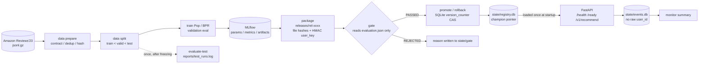

# ReviewPulse

An end-to-end **recommender-system MLOps pipeline** on a single machine, built on Amazon Reviews'23 (`All_Beauty`): data contract -> time-based split -> Pop / BPR training -> one shared offline evaluator -> MLflow -> hashed release bundles -> quality gate -> version-counter CAS promotion and rollback -> FastAPI recommendations -> request events and a monitoring summary.

The focus is not on how strong the model is. It is on **evaluation you can trust, releases you can audit, and results reported as they are**. On this dataset BPR loses to the popularity baseline, so the gate promotes Pop to production and the report says so.

[](https://github.com/tamsles/reviewpulse/actions/workflows/ci.yml)

- Experiment report (all real numbers): [`reports/experiment.md`](reports/experiment.md)
- Data exploration: [`reports/data-spike.md`](reports/data-spike.md)
- Design, invariants and evaluation protocol: [`docs/design.md`](docs/design.md)
- API and manifest schemas: [`docs/schemas/`](docs/schemas/)

## Architecture



Offline evaluation and the API call the **same** `rank()` (`src/reviewpulse/ranking.py`). Candidates are eligible items minus items the user has already seen. Every candidate is ranked (no sampled negatives), ties are broken by `item_id` ascending, and unknown users get the Pop fallback.

## 5-minute quick start (synthetic data, no download)

Requirements: Python 3.11, Git, bash (Git Bash on Windows), curl. Dependencies are installed with [uv](https://docs.astral.sh/uv/), which picks the CPU build of PyTorch.

```bash
git clone https://github.com/tamsles/reviewpulse.git
cd reviewpulse
python -m pip install uv
uv venv --python 3.11
source .venv/bin/activate          # Windows (Git Bash): source .venv/Scripts/activate
uv pip install -e ".[dev]"

pytest                             # ~230 tests, offline, synthetic fixture only
bash scripts/demo.sh               # full pipeline on 13 synthetic reviews
```

`scripts/demo.sh` runs in a temporary directory and does not touch the repository:
1. prepare -> split -> train Pop and BPR -> package.
2. Gate: **BPR is rejected (`NOT_BETTER_THAN_POP`)**, Pop passes.
3. Promote: dry-run first, then `--execute`.
4. Roll back A -> B -> A, then show that **promoting with a stale version number is rejected by the CAS**.
5. Start the API and call it for a known user, an unknown user and an invalid argument.
6. Print the monitoring summary.

## Reproducing on real data

```bash
python scripts/download_data.py --category All_Beauty   # ~94 MB into data/raw/ (git-ignored)
python scripts/data_spike.py --raw data/raw/All_Beauty.jsonl.gz
export RP_USER_KEY="<random secret, >= 16 chars>"     # keep it: releases are keyed by it

reviewpulse data prepare                 # configs/source.yaml
reviewpulse data split                   # configs/split.yaml: 2021-05-01 / 2022-01-01 / 2023-10-01
reviewpulse train --model Pop
reviewpulse train --model BPR --grid     # 8 configs, ~6 min on a laptop CPU
reviewpulse package --run-id <run_id>
reviewpulse gate --release-id <release_id>
reviewpulse promote --release-id <release_id> --expected-version 0            # dry-run
reviewpulse promote --release-id <release_id> --expected-version 0 --execute
reviewpulse serve                        # http://127.0.0.1:8000
```

Packaging expects a clean worktree (`git status` empty). Otherwise the release is marked dirty and the gate always rejects it. The test split can only be scored with `reviewpulse evaluate-test --run-id <id> --confirm-final` after `freeze-test`. This repository has already done that (see `reports/test_runs.log`), so it should not be run again.

### Runbook: making a promotion take effect
1. `reviewpulse promote --release-id <new> --expected-version <n> --execute`. This only moves the pointer.
2. **Restart the service.** The champion is loaded only at startup; there is no hot swap.
3. `curl http://127.0.0.1:8000/ready` and check that `loaded_release_id` is the new release.

Rollback is the same three steps with `reviewpulse rollback`. The target must have been promoted before and must still load completely.

### Docker
```bash
docker build -t reviewpulse .
docker run -p 8000:8000 -e RP_USER_KEY="$RP_USER_KEY" \
  -v "$PWD/releases:/app/releases:ro" -v "$PWD/state:/app/state" reviewpulse
```
The image contains only code, configs and dependencies. Releases and state are mounted as volumes. The container starts without a champion and `/ready` returns 503. On a Linux host, add `--user "$(id -u)"` if the mounted directories are not owned by uid 1000.

## Results (real data; details in [experiment.md](reports/experiment.md))

| Model | run_id | val NDCG@10 | val Recall@10 | **test NDCG@10** | **test Recall@10** | Gate |
|---|---|---|---|---|---|---|
| Pop | `0711a659` | 0.00842 | 0.01579 | **0.00797** | **0.02026** | PASSED -> champion |
| BPR (dim 64, lr 5e-3) | `9c62b80a` | 0.00458 | 0.00872 | 0.00296 | 0.00793 | `NOT_BETTER_THAN_POP` |

- Same split for both: `split_sha256 21a1d1c6…def3`. Validation has 2,122 valid users and test has 1,135. Test was run once per model, after the config was frozen.
- The 95% bootstrap CI of BPR - Pop on validation is [-0.0065, -0.0015]. The main reason: 92% of users have a single review, and most positive reviews in the evaluation windows are for items that did not exist during training.
- API server-side latency p95 is 2.4 ms (local machine, one worker, top_k=10).
- These are **offline** metrics. A rated review is not a purchase, and offline NDCG is not online CTR.

## Design decisions

- **Why a global time split**: a random split lets the model see the future. Training, seen sets and Pop scores use only data before `train_end`, and for test evaluation the seen set also stops at `train_end`. A counter-example test injects a future review into the raw data and checks that the train file stays byte-identical.
- **Why seen items include low ratings, and why exclusions are reported**: an item a user rated 1 star should not be recommended again either. Ground-truth items that were excluded (already seen, or cold) are reported next to the metrics, so a score cannot look good just because data was filtered.
- **Why promotion uses a version-counter CAS instead of comparing release IDs**: after A -> B -> A the release ID is A again, so comparing IDs cannot see that something changed in between (the ABA problem). `version_counter` only grows, so a request holding an old version always gets `CONFLICT`. The implementation is a single `UPDATE … WHERE version_counter = ?`.
- **Why Pop can be promoted**: Pop is the baseline and is exempt from the "must beat Pop" check. When BPR cannot beat Pop, promoting Pop keeps the service available and explainable instead of shipping a worse model.
- **Why the gate takes no scores as input**: `gate(release_id)` has one argument. Every number is read from the `evaluation.json` registered in the release bundle. Comparing against the Pop baseline requires the split, protocol and ground-truth hashes to match.
- **Why there is no online CTR**: there are no impressions or clicks, and offline NDCG must not pose as online performance. `monitor summary` always shows online quality as `UNAVAILABLE`.
- **Why the model is not loaded at import**: the service loads the champion in its lifespan hook. With no champion, or when loading fails, the service still starts, `/ready` returns 503 with a reason, and it **never silently switches to another release**. `/ready` reports the release actually loaded, not the latest pointer on disk.
- **Privacy**: release bundles, the event store and logs contain only `HMAC-SHA256(RP_USER_KEY, user_id)`, and the key is read only from the environment. Tests scan these artifacts to confirm that no raw `user_id` is present.

## What production would still need

This is a single-machine project. The following were left out on purpose (see [`docs/design.md`](docs/design.md#10-scope-deliberately-left-out)):

- **Deployment verification**: with multiple instances, track desired vs. actual state and provide `deploy verify` instead of checking `/ready` by hand.
- **Separate keys**: release bundles and telemetry should use different keys, with key rotation.
- **Drift monitoring and feedback retraining**: drift detection and a retraining state machine. Retraining changes the split, so the champion would need to be re-evaluated on the new split.
- **Cold start and content features**: excluded cold-item ground truth far outnumbers the ground truth that is kept, so text or item features are needed for fusion re-ranking.
- **Real online feedback**: impression and click logs and A/B tests to measure CTR or conversion.
- **Scale**: multiple workers or replicas, queued event writes, and an external model store and pointer store instead of SQLite.

## Data and citation

The data is Amazon Reviews'23, published by McAuley Lab. The dataset **has no formal license**; the maintainers say it is provided mainly for research ([discussion](https://huggingface.co/datasets/McAuley-Lab/Amazon-Reviews-2023/discussions/1)). This is a non-commercial portfolio project. The repository contains only a download script and statistical manifests, and it neither includes nor redistributes raw data or review text. The review is recorded in [`reports/data-spike.md`](reports/data-spike.md). `license_review_status` in `configs/source.yaml` still reads `pending` because the review happened after the config was frozen.

```bibtex
@article{hou2024bridging,
  title={Bridging Language and Items for Retrieval and Recommendation},
  author={Hou, Yupeng and Li, Jiacheng and He, Zhankui and Yan, An and Chen, Xiusi and McAuley, Julian},
  journal={arXiv preprint arXiv:2403.03952},
  year={2024}
}
```

## Layout

```text
src/reviewpulse/   data/ evaluation/ models/ release/ registry/ serving/ monitoring/ ranking.py cli.py
configs/           source / split / train / quality / runtime
tests/             230+ tests on a 13-row synthetic fixture (golden case in docs/design.md)
reports/           data-spike, experiment, frozen_config, test_runs.log, test_eval/
scripts/           download_data.py, data_spike.py, demo.sh
docs/              design.md, schemas/, examples/
```

## 日本語の概要

- **目的**：Amazon Reviews'23（All_Beauty、約 70 万件）を使い、推薦システムの MLOps パイプラインを一人で 5 日間かけて構築した、新卒向けのポートフォリオです。
- **技術スタック**：Python 3.11、pandas / PyArrow、PyTorch（BPR を自作）、MLflow、FastAPI、SQLite、Docker、GitHub Actions。
- **工夫した点①**：時系列分割と評価口径（既視商品の除外、除外件数の報告、手計算の Golden テスト）を厳密に定義し、未来データのリークを反例テストで防いでいます。
- **工夫した点②**：モデル・マッピング・既視集合を 1 つのリリースにまとめてハッシュで検証し、品質ゲートは登録済みの評価ファイルだけを読みます（スコアの手入力は不可）。
- **工夫した点③**：Champion の切り替えは `version_counter` による CAS で行い、A→B→A のロールバック後でも古いバージョン番号での更新は必ず失敗します。dry-run がデフォルトです。
- **工夫した点④**：モデルは import 時ではなく起動時に読み込みます。Champion がなくてもサービスは起動し、`/ready` は 503 を返します。ログやイベントには生の user_id を残しません。
- **結果**：このデータではユーザーの 92% がレビュー 1 件のみと非常に疎で、BPR（test NDCG@10 0.0030）は人気順 Pop（0.0080）に負けました。品質ゲートが BPR を却下し、Pop を本番モデルとして昇格させています。
- **正直さ**：レビュー評価は購入ではなく、オフライン NDCG はオンライン CTR ではありません。test 評価は設定を凍結したうえで、各モデル 1 回だけ実施しました。
- **データ**：Amazon Reviews'23 には正式なライセンスがなく、管理者は主に研究目的での提供としています。本プロジェクトは非営利で、生データやレビュー本文は再配布していません。
- **今後**：コールドスタート向けの特徴量融合、ドリフト監視、デプロイ検証、二重鍵などは設計のみで、未実装です。
