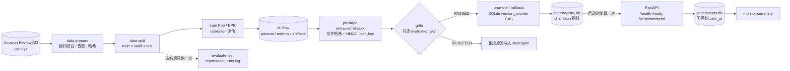

# ReviewPulse

用 Amazon Reviews'23（`All_Beauty`）做的一个**推荐系统 MLOps 闭环**单机作品：数据契约 → 时间切分 → Pop / BPR 训练 → 统一离线评估 → MLflow → 带哈希的 Release 包 → 质量门禁 → 版本号 CAS 晋升 / 回滚 → FastAPI 推荐 → 请求事件与监控汇总。重点不在模型有多强，而在**评估口径可信、发布过程可审计、结果如实报告**：在这份数据上 BPR 输给了 Pop，门禁就把 Pop 晋升为线上模型，报告也照实写。

[](https://github.com/tamsles/reviewpulse/actions/workflows/ci.yml)

- 实验报告（所有真实数字）：[`reports/experiment.md`](reports/experiment.md)
- 数据探查：[`reports/data-spike.md`](reports/data-spike.md) ・ 开发记录：[`reports/progress.md`](reports/progress.md)
- 规格（v1.2）：[`docs/specs/`](docs/specs/) ・ 范围决策：[ADR-0009](docs/specs/specs/decisions/ADR-0009-v1.2-five-day-scope.md)

## 架构



离线评估和 API 调用的是**同一个** `rank()`（`src/reviewpulse/ranking.py`）：候选 = 可推荐商品 − 已见商品，全量排序，分数并列时按 item_id 升序，不认识的用户走 Pop 回退。

## 5 分钟快速开始（合成数据，不需要下载）

需要：Python 3.11、Git、bash（Windows 用 Git Bash）、curl。依赖用 [uv](https://docs.astral.sh/uv/) 安装，会自动选 CPU 版 PyTorch。

```bash
git clone https://github.com/tamsles/reviewpulse.git
cd reviewpulse
python -m pip install uv
uv venv --python 3.11
source .venv/bin/activate          # Windows (Git Bash): source .venv/Scripts/activate
uv pip install -e ".[dev]"

pytest                             # ~230 tests, offline, synthetic fixture only
bash scripts/demo.sh               # full pipeline on 13 synthetic reviews
```

`scripts/demo.sh` 在一个临时目录里完成以下步骤，不会修改仓库：
1. prepare → split → 训练 Pop 和 BPR → 打包。
2. 门禁：**BPR 被拒（`NOT_BETTER_THAN_POP`）**，Pop 通过。
3. 晋升：先 dry-run，再 `--execute`。
4. A→B→A 回滚，然后演示**拿旧版本号晋升会被 CAS 拒绝**。
5. 启动 API，分别请求已知用户、未知用户和一个错误参数。
6. 输出监控汇总。

## 真实数据复现

```bash
python scripts/download_data.py --category All_Beauty   # ~94 MB into data/raw/ (git-ignored)
python scripts/data_spike.py --raw data/raw/All_Beauty.jsonl.gz
export RP_USER_KEY="<random secret, >= 16 chars>"     # keep it: releases are keyed by it

reviewpulse data prepare                 # configs/source.yaml
reviewpulse data split                   # configs/split.yaml: 2021-05-01 / 2022-01-01 / 2023-10-01
reviewpulse train --model Pop
reviewpulse train --model BPR --grid     # 8 configs, ~6 min on a laptop CPU
reviewpulse package --run-id <run_id>
reviewpulse gate --release-id <release_id>
reviewpulse promote --release-id <release_id> --expected-version 0            # dry-run
reviewpulse promote --release-id <release_id> --expected-version 0 --execute
reviewpulse serve                        # http://127.0.0.1:8000
```

注意：打包要求工作区是干净的（`git status` 为空），否则 release 会被标记为 dirty，门禁一律拒绝。test 评估只能用 `reviewpulse evaluate-test --run-id <id> --confirm-final`，并且要先 `freeze-test` 冻结配置。本仓库已经执行过（见 `reports/test_runs.log`），不应该再跑。

### 运行手册：晋升后让服务生效
1. `reviewpulse promote --release-id <new> --expected-version <n> --execute`。这一步只移动指针。
2. **重启服务**。服务只在启动时加载 champion，运行中不会热切换。
3. `curl http://127.0.0.1:8000/ready`，确认 `loaded_release_id` 是新的 release。
回滚也是同样的三步：用 `reviewpulse rollback`。回滚目标必须是以前晋升过、并且现在仍能完整加载的 release。

### Docker
```bash
docker build -t reviewpulse .
docker run -p 8000:8000 -e RP_USER_KEY="$RP_USER_KEY" \
  -v "$PWD/releases:/app/releases:ro" -v "$PWD/state:/app/state" reviewpulse
```
镜像里只有代码、配置和依赖；release 和 state 通过卷挂载。没有 champion 时容器也能启动，`/ready` 返回 503。在 Linux 宿主上，如果挂载目录不属于 uid 1000，请加 `--user "$(id -u)"`。

## 结果（真实数据，详见 [experiment.md](reports/experiment.md)）

| 模型 | run_id | val NDCG@10 | val Recall@10 | **test NDCG@10** | **test Recall@10** | 门禁 |
|---|---|---|---|---|---|---|
| Pop | `0711a659` | 0.00842 | 0.01579 | **0.00797** | **0.02026** | PASSED → champion |
| BPR (dim 64, lr 5e-3) | `9c62b80a` | 0.00458 | 0.00872 | 0.00296 | 0.00793 | `NOT_BETTER_THAN_POP` |

- 同一个切分：`split_sha256 21a1d1c6…def3`；validation 有效用户 2,122 人，test 有效用户 1,135 人。test 在配置冻结后每个模型只跑了一次。
- validation 上 BPR − Pop 的 95% bootstrap 置信区间是 [−0.0065, −0.0015]。主要原因是 92% 的用户只有 1 条评论，而评估窗口里的正向评价大多落在新商品上。
- API 服务端延迟 p95 是 2.4 ms（本机，单 worker，top_k=10）。
- 这些都是**离线**指标。评分评论 ≠ 购买，离线 NDCG ≠ 线上 CTR。

## 设计上的取舍

- **为什么用全局时间切分**：随机切分会让模型"看到未来"。所有训练、已见集合、Pop 分数都只用 `train_end` 之前的数据；test 评估时已见集合也只算到 `train_end`。有反例测试保证：往原始数据里注入一条未来评论，train 文件的字节完全不变。
- **为什么已见集合包括低分评论、为什么报告剔除计数**：用户打过 1 星的商品也不应该再推荐。被剔除的真值（已见的、冷商品的）都会随指标一起报告，防止出现"筛过之后才好看"的分数。
- **为什么晋升用版本号做 CAS，而不是比较 release_id**：A→B→A 之后 release_id 又变回 A，比较 release_id 看不出中间发生过变化（ABA 问题）。`version_counter` 只增不减，所以拿着旧版本号的请求一定返回 `CONFLICT`。实现上就是一条 `UPDATE … WHERE version_counter = ?`。
- **为什么 Pop 可以晋升**：Pop 是基线，免检"必须超过 Pop"这一条。当 BPR 赢不了 Pop 时，晋升 Pop 能保证服务可用、结果可解释，而不是硬上一个更差的模型。
- **为什么门禁不接受手填分数**：`gate(release_id)` 只有一个参数，所有数字都从 release 包里登记过的 `evaluation.json` 读取。和 Pop 基线比较时，要求两边的切分、协议、真值三个哈希都一致。
- **为什么不报线上 CTR**：这里没有曝光和点击，离线 NDCG 不能冒充线上效果，所以 `monitor summary` 里的线上质量固定显示 `UNAVAILABLE`。
- **为什么 import 时不加载模型**：服务在 lifespan 里加载 champion。没有 champion 或加载失败时，服务照样能启动，`/ready` 返回 503 并给出原因，**不会偷偷换用别的 release**。`/ready` 报告的是实际加载的 release，而不是磁盘上最新的指针。
- **隐私**：Release 包、事件库和日志里只有 `HMAC-SHA256(RP_USER_KEY, user_id)`，密钥只从环境变量读。有测试扫描这些产物，确认里面没有原始 user_id。

## 生产化还需要什么

这是一个单机演示。v1.2 有意砍掉了下面这些内容，理由和砍掉的位置见 [`docs/specs/CHANGES-v1.2.md`](docs/specs/CHANGES-v1.2.md) 和 [ADR-0009](docs/specs/specs/decisions/ADR-0009-v1.2-five-day-scope.md)。v1.1 的完整设计文档不在这个仓库里。

- **部署核验**：多实例部署时，需要区分 desired / actual 两种状态，并提供 `deploy verify`，而不是靠人工看 `/ready`。
- **双密钥**：发布包和遥测应该用两把不同的密钥，并支持密钥轮换。
- **Drift 监控和反馈重训**：数据漂移检测，以及重训状态机。重训会换切分，所以届时需要在新切分上重新评估 Champion（GATE-04）。
- **冷启动和内容特征**：被剔除的冷商品真值远多于保留下来的真值，需要用文本或商品特征做融合重排序。
- **真实的线上反馈**：曝光和点击日志、A/B 测试，才能衡量 CTR 或转化率。
- **规模**：多 worker 或多副本、事件写入队列化、模型服务和指针存储外置（替代 SQLite）。

## 数据与引用

数据来自 McAuley Lab 发布的 Amazon Reviews'23。这份数据**没有正式许可证**，维护者表示主要供研究用途（[说明](https://huggingface.co/datasets/McAuley-Lab/Amazon-Reviews-2023/discussions/1)）。本项目是非商业的作品，仓库里只有下载脚本和统计 manifest，不包含、也不再分发原始数据和评论原文。核对记录见 [`reports/data-spike.md`](reports/data-spike.md)。`configs/source.yaml` 里的 `license_review_status` 仍是 `pending`，因为核对是在配置冻结之后做的。

```bibtex
@article{hou2024bridging,
  title={Bridging Language and Items for Retrieval and Recommendation},
  author={Hou, Yupeng and Li, Jiacheng and He, Zhankui and Yan, An and Chen, Xiusi and McAuley, Julian},
  journal={arXiv preprint arXiv:2403.03952},
  year={2024}
}
```

## 目录

```text
src/reviewpulse/   data/ evaluation/ models/ release/ registry/ serving/ monitoring/ ranking.py cli.py
configs/           source / split / train / quality / runtime
tests/             230+ tests on a 13-row synthetic fixture (golden case from specs/02)
reports/           data-spike, experiment, progress, frozen_config, test_runs.log
scripts/           download_data.py, data_spike.py, demo.sh
docs/specs/        v1.2 specs, schemas, ADRs
```

## 日本語の概要

- **目的**：Amazon Reviews'23（All_Beauty、約 70 万件）を使い、推薦システムの MLOps パイプラインを一人で 5 日間かけて構築した、新卒向けのポートフォリオです。
- **技術スタック**：Python 3.11、pandas / PyArrow、PyTorch（BPR を自作）、MLflow、FastAPI、SQLite、Docker、GitHub Actions。
- **工夫した点①**：時系列分割と評価口径（既視商品の除外、除外件数の報告、手計算の Golden テスト）を厳密に定義し、未来データのリークを反例テストで防いでいます。
- **工夫した点②**：モデル・マッピング・既視集合を 1 つのリリースにまとめてハッシュで検証し、品質ゲートは登録済みの評価ファイルだけを読みます（スコアの手入力は不可）。
- **工夫した点③**：Champion の切り替えは `version_counter` による CAS で行い、A→B→A のロールバック後でも古いバージョン番号での更新は必ず失敗します。dry-run がデフォルトです。
- **工夫した点④**：モデルは import 時ではなく起動時に読み込みます。Champion がなくてもサービスは起動し、`/ready` は 503 を返します。ログやイベントには生の user_id を残しません。
- **結果**：このデータではユーザーの 92% がレビュー 1 件のみと非常に疎で、BPR（test NDCG@10 0.0030）は人気順 Pop（0.0080）に負けました。品質ゲートが BPR を却下し、Pop を本番モデルとして昇格させています。
- **正直さ**：レビュー評価は購入ではなく、オフライン NDCG はオンライン CTR ではありません。test 評価は設定を凍結したうえで、各モデル 1 回だけ実施しました。
- **データ**：Amazon Reviews'23 には正式なライセンスがなく、管理者は主に研究目的での提供としています。本プロジェクトは非営利で、生データやレビュー本文は再配布していません。
- **今後**：コールドスタート向けの特徴量融合、ドリフト監視、デプロイ検証、二重鍵などは設計のみで、未実装です。
